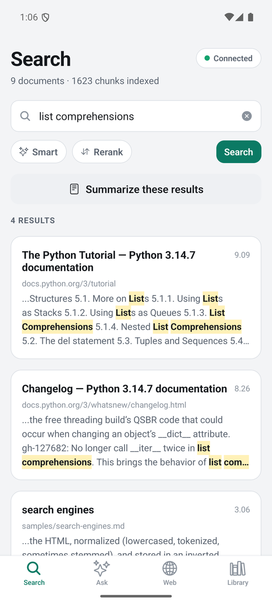
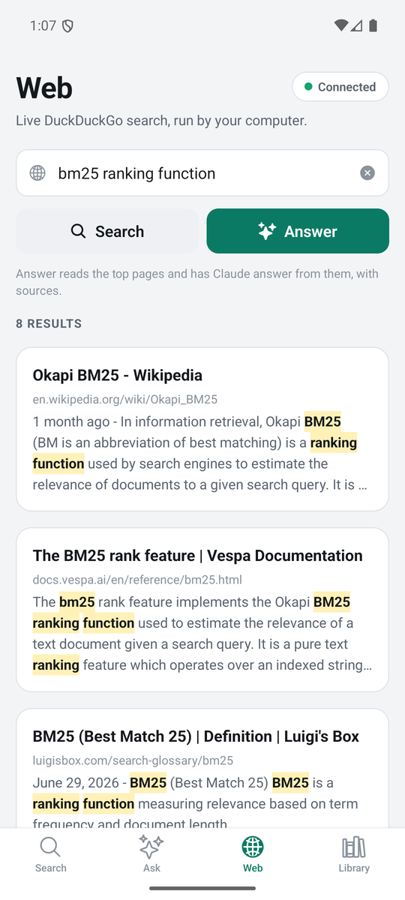
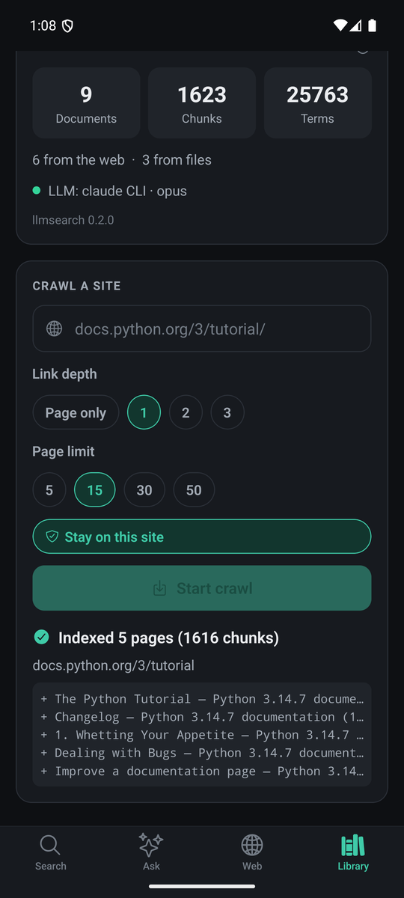

# llmsearch Mobile

React Native (Expo) app for [llmsearch](https://github.com/DimNt3000/llmsearch), a
search engine built from scratch in Python with Claude layered on top. From the
phone you can search your own index, ask questions that are answered with
citations, search the live web, and crawl new sites into the index. The index
and the model stay on your computer: the app talks to `llmsearch serve` over the
local network.

<p>
  
  
  
</p>

**Android:** download the installable APK from the
[latest release](https://github.com/DimNt3000/llmsearch-mobile/releases/latest).
It needs `llmsearch serve` running on a computer on the same network.

## Features

- **Search** the index on your computer with BM25. Matching words are
  highlighted, a tap expands the full passage, and web results open in the
  browser. **Smart** lets the model rewrite the query, **Rerank** lets it
  reorder the hits, and **Summarize** writes a digest of the results.
- **Ask** a question and get an answer written only from your index. Every
  claim carries a `[n]` citation; tapping one scrolls to its source, and
  sources the answer never cited are marked as such. Answers can be shared.
- **Web** runs a live DuckDuckGo search, or **Answer** has the computer read the
  top pages and answer from their content, with the pages as sources.
- **Library** pairs the app with the server, shows the index size and the
  active LLM backend, and crawls a new site with a link depth, a page limit,
  and a same-site switch. Progress and the crawl log update live, and a crawl
  can be stopped at any time.
- Light and dark themes that follow the system setting.
- Model calls take 10 to 60 seconds, so every wait shows an elapsed timer and a
  Cancel button.

## How it works

```
      PHONE (this app)                               COMPUTER
 ┌────────────────────────┐                 ┌─────────────────────────────┐
 │ Expo Router tabs       │   HTTP + JSON   │ llmsearch serve             │
 │ typed API client       │ ──────────────▶ │  token check, validation    │
 │ connection state       │  Bearer token   │  shared service layer       │
 │ SecureStore (token)    │ ◀────────────── │  SQLite index · BM25        │
 └────────────────────────┘  local network  │  Claude · DuckDuckGo        │
                                            └─────────────────────────────┘
```

The server runs the same pipeline as the llmsearch CLI, through the service
layer both of them share. Its endpoints, error codes, and token scheme are
documented in the
[llmsearch README](https://github.com/DimNt3000/llmsearch#http-api-and-mobile-app).

## Stack

- Expo SDK 57, React Native 0.86, React 19.2, TypeScript 6 in strict mode
- Expo Router for file-based tab navigation with typed routes
- expo-secure-store for the token (Keychain on iOS, Keystore on Android)
- react-native-web, so the same code runs in a desktop browser for testing
- No state, networking, or Markdown libraries: `fetch`, React context, and a
  small hand-written parser cover what the app needs

## Getting started

1. On the computer, get llmsearch, index something, and start the server:

   ```
   git clone https://github.com/DimNt3000/llmsearch.git
   cd llmsearch
   python run.py add samples
   python run.py serve
   ```

   It prints the address to use from the phone and the token:

   ```
   llmsearch server v0.2.0
     Local:    http://127.0.0.1:8765
     Network:  http://192.168.1.42:8765   <- enter this in the app
     Token:    (a random 24-character token)
   ```

   Asking and summarizing need Claude on the computer, through an
   `ANTHROPIC_API_KEY` or a signed-in Claude Code CLI. Search, web search, and
   crawling work without it.

2. On the phone, install the APK from the releases page, or run the app from
   source with [Expo Go](https://expo.dev/go):

   ```
   git clone https://github.com/DimNt3000/llmsearch-mobile.git
   cd llmsearch-mobile
   npm install
   npx expo start
   ```

   Scan the QR code with Expo Go. The phone and the computer need to share a
   network.

3. Open the **Library** tab, enter the network address and the token, and tap
   **Connect**. The app remembers both, so this happens once.

## Installable Android app

The app builds into a standalone APK that installs like any other app, with no
Expo Go needed:

```
npx expo prebuild --platform android
cd android
gradlew assembleRelease -PreactNativeArchitectures=arm64-v8a,x86_64
```

The APK lands in `android/app/build/outputs/apk/release/app-release.apk`. The
`android` folder is generated from `app.json` and is not committed; run
`prebuild` again after changing the config. For a phone alone,
`-PreactNativeArchitectures=arm64-v8a` builds a smaller APK.

- Build with **JDK 17 or 21**. Newer JDKs print a native-access warning from
  the `prefab` tool that the Android Gradle plugin treats as a failure.
- `app.json` enables cleartext traffic through `expo-build-properties`. The
  server speaks plain `http://` on the local network, and release builds block
  that by default. Expo Go allows it, so the problem only shows up in a
  standalone build.
- `expo-system-ui` is installed so that a standalone build follows the system
  dark theme the way Expo Go does.
- Native libraries are stored compressed (`useLegacyPackaging`), which takes
  the arm64 APK from about 41 MB to 27 MB.
- On Windows, react-native-gesture-handler's C++ build produces object paths
  over 260 characters, which the ninja bundled with the SDK's CMake 3.22
  cannot open. The config plugin in `plugins/` raises CMake's object path
  budget so that CMake hashes those paths short enough; its comment has the
  arithmetic. It covers checkouts up to 35 characters deep, such as
  `C:\Users\<name>\dev\llmsearch-mobile`.
- The build is signed with the debug key, which is fine for your own devices
  but not for a store.

## Testing

```
npm test            # 27 unit tests: the answer parser and the URL and text helpers
npm run typecheck   # the app and the tests, both in strict mode
npm run lint        # expo lint
```

The parser and helpers have no React Native imports, so Node's built-in test
runner executes the TypeScript directly, with no Jest or Babel setup (Node
22.18 or newer runs TypeScript natively). The server side has its own harness
in the llmsearch repo, which drives the real HTTP API over sockets.

The app was checked end to end against a live server on an Android 16 emulator
(Pixel 7) and in a desktop browser: pairing with a wrong token and with an
unreachable address, search, web search, a crawl from the phone with live
progress, cancelling long requests, the dark theme, and the saved connection
surviving an app restart. The release APK was checked separately, because it
differs from Expo Go in exactly the places that break: it pairs over the
computer's network address in plain HTTP, follows the system dark theme, and
keeps the crawl field above the keyboard.

## Engineering notes

- **One error type.** Server errors (`unauthorized`, `no_context`,
  `llm_unavailable`, `busy`, and so on) and transport failures (`offline`,
  `timeout`, `cancelled`, `bad_response`) all become an `ApiError` with a code.
  Screens branch on the code: an Ask with nothing relevant in the index offers
  to crawl a site, and an unavailable model gets an explanation instead of a
  raw error.
- **No stale results.** Starting a request aborts the previous one of the same
  kind, so a slow answer can never overwrite a newer one. Connection checks
  carry a sequence number, and an outdated check never wins.
- **Cancel is real on the phone, polite on the server.** Cancelling aborts the
  HTTP request. The computer still finishes the model call, then finds the
  connection closed and drops the answer without logging an error.
- **Timeouts per kind of work:** 15 seconds for search and control calls, 30
  for live web search, 5 minutes for anything that waits on the model.
- **Hermes-safe.** React Native's `URL` and `URLSearchParams` are incomplete and
  Hermes has no full `Intl`, so query strings, URL checks, and time formatting
  are written by hand and unit-tested.
- **Native answer rendering.** Answers come back as light Markdown. A 120-line
  parser turns the subset the server's prompts produce (paragraphs, lists,
  headings, bold, italics, code, and citations) into native `Text`, with no
  WebView. A citation outside the source list is shown but not tappable.
- **Coming back to the app re-checks the server,** because that is when a
  sleeping laptop or a changed network shows up.
- **Keyboard handling for edge-to-edge.** The app draws behind the system bars,
  as Android 15 and later require, and there the keyboard no longer shrinks
  the React Native view; it simply covered fields low on the page. Every screen
  now pads itself with `KeyboardAvoidingView` on Android as well as iOS, so the
  crawl URL stays above the keyboard.
- **Crawls run on the server.** The phone starts a job and polls it once a
  second. The server keeps the last job, so reopening the app shows how it
  ended, and a second crawl while one runs gets a clear "busy" answer.

## Security

- The token is stored with expo-secure-store, in the Keychain or Keystore,
  never in plain storage. In a desktop browser, used only for testing, it
  falls back to `localStorage`.
- Traffic between the phone and the computer is plain HTTP, token included,
  so use the app on networks you trust or over a VPN such as Tailscale.
  `llmsearch serve --new-token` rotates the token and unpairs every phone.
- The server validates every input, caps request bodies, and never returns
  internal error details. See the llmsearch README for the full list.
- `npm audit` reports moderate advisories inside Expo SDK 57's own
  dependencies: `uuid` in the iOS project tooling, which does not ship in the
  app, and `decode-uri-component` in expo-router's deep-link parser. The fix
  npm suggests is a downgrade of several SDK versions, so they wait for an
  upstream update.

## Limitations

- Answers arrive whole rather than streamed, so a long answer means a wait
  with a timer instead of text appearing as it is written.
- Only Android has a standalone build. On iOS the app runs through Expo Go; a
  standalone iOS build would also need App Transport Security and local
  network permission settings, which are not configured.
- The server runs one crawl at a time.

## Structure

```
src/app/            Screens: the four tabs and the root layout (Expo Router)
src/api/            Typed API client and response types
src/state/          Connection context: saved server, status, index stats
src/components/     UI kit (buttons, fields, banners) and answer/result views
src/lib/            Answer parser, URL and text helpers, request hooks, storage
src/theme.ts        Light and dark palettes, spacing, type scale
plugins/            Config plugin for the Windows path length limit
tests/              Unit tests run by Node's test runner
docs/               Screenshots for this README
```

## License

MIT
